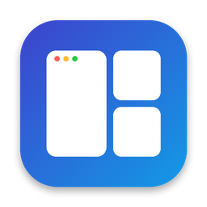
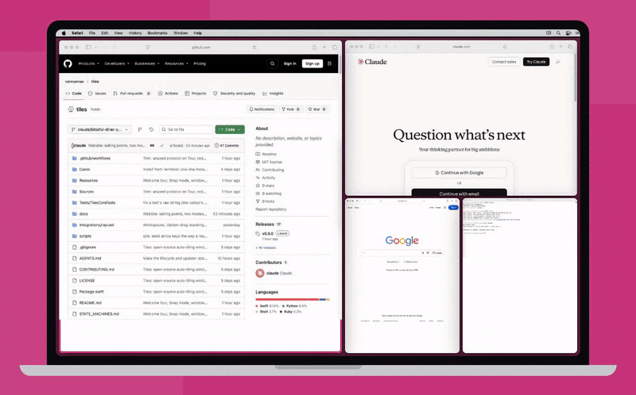
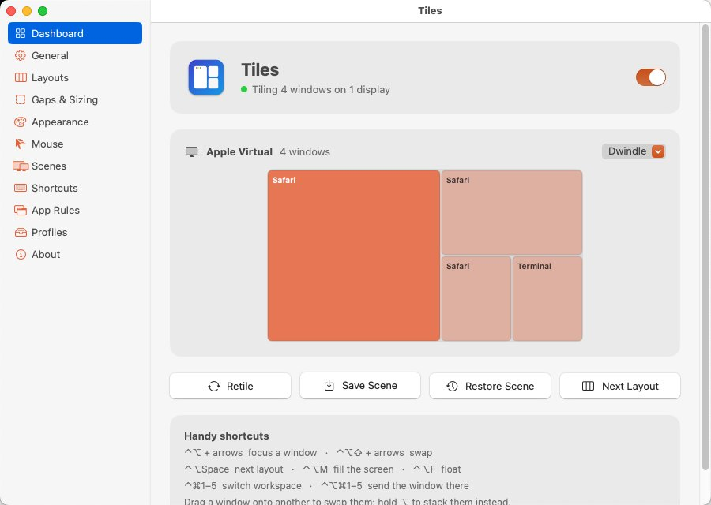
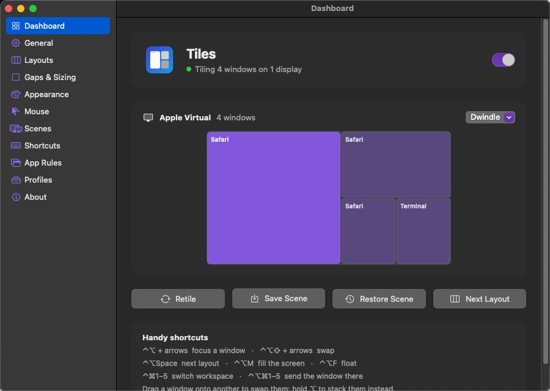
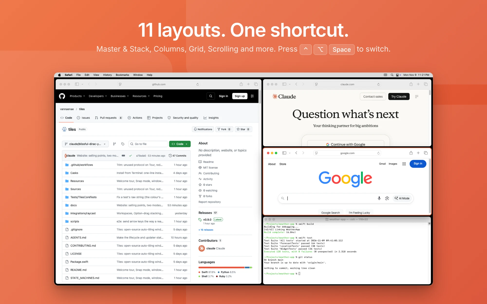
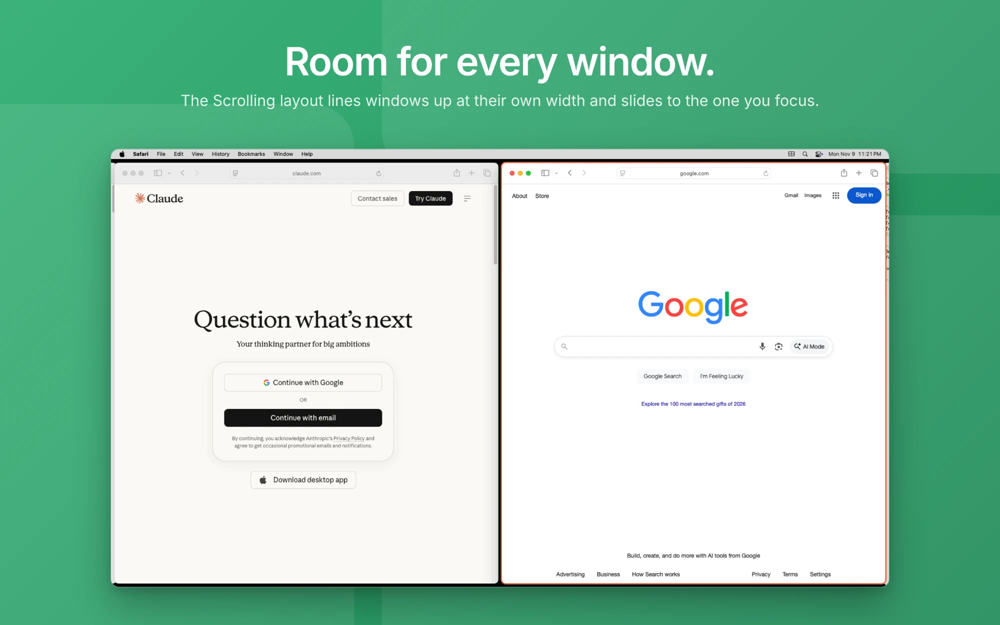
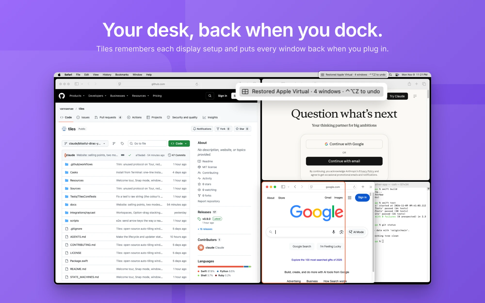

<p align="center"></p>

<h1 align="center">Tiles</h1>

<p align="center"><a href="https://github.com/vannaenae/tiles/releases/latest"></a><br><sub>A SOULSPCE Collective product</sub></p>

<p align="center"><b>A free, open-source auto-tiling window manager for macOS.</b><br>
Every window snaps into place the moment it opens. Every screen gets the right layout. Your desk setup comes back when you dock.</p>

<p align="center"><a href="https://the-tiles.vercel.app/">Website</a> · <a href="https://github.com/vannaenae/tiles/releases/latest">Download</a> · <a href="#keyboard-shortcuts">Shortcuts</a></p>

<p align="center"><a href="https://the-tiles.vercel.app/"></a><br><sub>The interactive demo from the <a href="https://the-tiles.vercel.app/">website</a>: drag the windows yourself there.</sub></p>

```bash
curl -fsSL https://github.com/vannaenae/tiles/releases/latest/download/install.sh | bash
```

- Lives in the menu bar, the Dock, or both: your choice.
- macOS 13 Ventura or later, Apple silicon and Intel.
- MIT licensed. No account, no telemetry, nothing leaves your Mac. Updates itself from GitHub releases.

<p align="center">
  
  
</p>

<p align="center">
  
  
  
</p>

<sub>The dashboard and the screenshots further down are Tiles running on a real Mac (GitHub's macOS test machine, 1024×768). The animation at the top is the website's demo, which runs the same layout maths as the app.</sub>

---

## Why Tiles

| | Tiles |
|---|---|
| Price | Free, MIT licensed |
| macOS | 13 Ventura and later |
| Layouts | 11: Dwindle, Master & Stack, Wide Master, Centered Master, Columns, Thirds, Rows, Grid, Monocle, Scrolling, Float |
| Ultrawide | Detected automatically. Centered Master by default, and a width cap stops any tile stretching across a 49" screen |
| Full screen | Each display holds as many tiles as fit its size; further windows stack on the last tile |
| Focus | One shortcut lets a window fill its display; press again to put it back |
| Settings | Settings window with a live preview for laptop, 27", 34" and 49" displays, plus a focus outline in your colour |
| Scenes | Saved automatically per set of displays, restored when that set reconnects, nameable, one-step undo |
| Mouse | Drag a window onto another to swap. Drag to another display to move. Resize to change the split |
| Keyboard | 50+ global shortcuts, all remappable |
| Automation | `tiles://` URL scheme and a `tiles` CLI for Raycast, Alfred, Shortcuts, skhd |
| App | A dashboard showing every display and its windows live, plus settings for layouts, gaps, colours, shortcuts, app rules and scenes |
| Look | Light, Dark or follow macOS, with five colour themes: orange, blue, green, purple, pink |
| Profiles | Save your settings as named profiles, switch in one click, export and import between Macs |
| Config | Also one plain JSON file, hot-reloaded on save |
| Per-display | Different layout for each monitor, by name or by shape |
| Rules | Float any app, or send its windows to a chosen display and the main tile |
| Stacks | ⌥-drag a window onto another to stack them. A badge counts windows sharing a tile; click it to flip through |
| Workspaces | Up to 9 per display: `⌃⌥1`–`⌃⌥9` to switch, `⌃⌥⇧1`–`⌃⌥⇧9` to send a window. No need to turn off SIP |
| Scroll to pan | In Scrolling, hold `⌃⌥` and swipe or scroll to slide the strip |
| Animation | Optional: windows slide into place instead of jumping |
| Snap mode | Prefer to place windows yourself? Windows stay put, and dragging one to a screen edge or corner snaps it to half, a quarter or the full screen |
| Window finder | `⌃⌥G`, type a few letters, Return: you're in that window, even on another workspace |
| Welcome tour | Five short pages on first launch that show how it all works |
| Raycast | Ready-made script commands in `integrations/raycast` |
| Languages | English, Spanish, French and German, following your Mac's language |
| Updates | Checks GitHub daily and installs updates signed by the Tiles developer, in place |
| Privacy | Scenes store app identifiers only, never window titles |

## Install

**Terminal (easiest):** paste this into Terminal. It downloads the latest Tiles, puts it in Applications and opens it, with no security prompt.

```bash
curl -fsSL https://github.com/vannaenae/tiles/releases/latest/download/install.sh | bash
```

Run the same line again to update. To remove Tiles: `curl -fsSL https://github.com/vannaenae/tiles/releases/latest/download/install.sh | bash -s uninstall`

**Homebrew:**

```bash
brew tap vannaenae/tiles https://github.com/vannaenae/tiles
```

```bash
brew install --cask vannaenae/tiles/tiles
```

Update with `brew upgrade --cask --greedy tiles`.

**Download:** grab `Tiles-x.y.z.zip` from [Releases](https://github.com/vannaenae/tiles/releases), unzip, drag `Tiles.app` to Applications.

First launch only: right-click `Tiles.app` → **Open** → **Open** (releases are signed but not notarized). If macOS still refuses, run `xattr -dr com.apple.quarantine /Applications/Tiles.app`.

**Build from source** (Xcode 15+ or the Swift 5.9+ toolchain):

```bash
git clone https://github.com/vannaenae/tiles.git
```

```bash
cd tiles && ./scripts/build-app.sh && open dist/Tiles.app
```

### Accessibility permission

Tiles uses the macOS Accessibility API to read each window's position, size and app, and to move it. On first launch it asks you to enable it in **System Settings → Privacy & Security → Accessibility**, then starts on its own.

If you rebuild from source, macOS may treat the new build as a different app. Remove the old Tiles entry from the Accessibility list and add it again.

## Layouts

| Layout | What it does | Best for |
|---|---|---|
| **Dwindle** | Each new window halves the remaining space, splitting along the longer side | Laptops, general use (default) |
| **Master & Stack** | Main window on the left, the rest stacked on the right | Editor + references |
| **Wide Master** | Main window on top, the rest side by side below | Vertical monitors |
| **Centered Master** | Main window in the middle, others alternate right and left | Ultrawides (default there) |
| **Columns** | Equal columns | Ultrawides, comparing documents |
| **Thirds** | Two thirds + one third; the right third stacks from three windows | Main app + sidebar apps |
| **Rows** | Equal rows | Vertical monitors |
| **Grid** | Balanced grid | Dashboards, many small windows |
| **Scrolling** | Windows in a row wider than the screen, each at its own width. Focus one and the row scrolls to it; the rest wait at the edge | Laptops, people who hate squashed windows |
| **Monocle** | Every window full-screen; cycle with focus keys | Small screens, deep focus |
| **Float** | Tiles leaves this display alone | Presentations |

Each display has its own layout. Pick one from the menu bar or cycle with `⌃⌥Space`. To jump straight to one, give it a shortcut in Settings → Shortcuts.

## Keyboard shortcuts

Every default is **⌃⌥ (Control + Option)** plus one key, which apps rarely claim. Add **⇧ Shift** to move the window instead of the focus. Forgot one? **`⌃⌥/`** pops up a cheat sheet.

| Shortcut | Action |
|---|---|
| `⌃⌥` + `H` `J` `K` `L` or arrows | Focus window left / down / up / right |
| `⌃⌥⇧` + `H` `J` `K` `L` or arrows | Swap with window left / down / up / right |
| `⌃⌥↩` | Promote focused window to master (again to swap back) |
| `⌃⌥N` / `⌃⌥P` | Focus next / previous window |
| `⌃⌥Space` / `⌃⌥⇧Space` | Next / previous layout |
| `⌃⌥M` | Focus: fill the display with this window, again to put it back |
| `⌃⌥W` | Scrolling: cycle the window's width through ⅓, ½, ⅔ and full |
| `⌃⌥C` | Centre the window (Scrolling, or a floating window) |
| `⌃⌥=` / `⌃⌥-` | Grow / shrink master area (in Scrolling: the window's width by 5%) |
| `⌃⌥,` / `⌃⌥.` | More / fewer master windows |
| `⌃⌥⇧=` / `⌃⌥⇧-` | Bigger / smaller gaps |
| `⌃⌥]` / `⌃⌥[` | Move window to next / previous display |
| `⌃⌥F` | Float or tile the focused window |
| `⌃⌥T` | Turn tiling on or off |
| `⌃⌥R` | Retile everything |
| `⌃⌥S` | Save scene for this display setup |
| `⌃⌥Z` | Undo the last scene restore |
| `⌃⌥1` … `⌃⌥9` | Show workspace 1–9 on the active display |
| `⌃⌥⇧1` … `⌃⌥⇧9` | Send the focused window to workspace 1–9 |
| `⌃⌥/` | Pop up the cheat sheet of everyday shortcuts |
| `⌃⌥G` | Find a window by name |

Remap anything in the config file (see below). Shortcuts use key positions on a US layout.

## Mouse

- **Drag a window onto another** to swap them.
- **Drag a window to another display** to move it there.
- **Hold ⌥ (Option) as you drop** to stack the window with the one underneath. A badge shows the count; click it to flip through. Drag it out to unstack.
- **Hold ⌃⌥ and scroll** (or swipe sideways) in the Scrolling layout to slide the strip.
- **Resize a window** with the mouse and the split follows (master ratio in Master & Stack, Wide Master, Centered Master and Dwindle). Other resizes snap back.

## Workspaces

Each display has up to nine workspaces, each with its own set of windows. `⌃⌥2` shows workspace 2 on the display you're using, and `⌃⌥⇧2` sends the focused window there. ⌘-Tab or a Dock click to a window on another workspace switches to it. The menu bar and dashboard show which workspaces hold windows.

Give a workspace a name and its own layout in Settings → Layouts → Desktops ("Music" in Columns); each one also remembers the layout you last used on it.

Windows on hidden workspaces wait just off the corner of the screen (the approach AeroSpace uses), so switching is instant and needs no change to System Integrity Protection. Turning tiling off or quitting Tiles always brings them back.

## Scenes

A scene is the arrangement for one combination of displays: each display's layout, split ratio, and which apps sit in which tile.

- Tiles saves the scene automatically a few seconds after you rearrange things.
- When you dock or undock, Tiles waits for the displays to settle and restores the scene saved for that exact set.
- A notice like *Restored LG UltraFine · 3 windows* appears in the menu bar. `⌃⌥Z` or **Undo Scene Restore** puts things back.
- `⌃⌥S` saves on demand; **Restore Scene** in the menu re-applies it.
- Name a scene (*Desk*, *Laptop*, *Studio*) with **Save Scene for This Setup…** in the menu, or in Settings → Scenes, where you can rename any saved scene by clicking its name. The name shows in the menu and in the restore notice: *Restored Desk · 3 windows*. Autosave keeps the name.
- Scenes store bundle identifiers (`com.apple.Safari`), never window titles. They live in `~/Library/Application Support/Tiles/scenes.json`.

## Configuration

**Settings…** (`⌘,` from the menu) covers the everyday options with a live preview. Everything, including rules and shortcuts, also lives in `~/.config/tiles/config.json` for anyone who prefers editing a file; Tiles reloads it the moment you save. Every key is optional; anything you leave out uses the default.

```json
{
  "defaultLayout": "dwindle",
  "ultrawideLayout": "centered-master",
  "displays": {
    "Built-in": "monocle",
    "DELL U3423WE": "columns"
  },
  "layout": {
    "innerGap": 8,
    "outerGap": 8,
    "masterRatio": 0.55,
    "masterCount": 1,
    "ultrawideAspectRatio": 2.0,
    "ultrawideSingleWindowRatio": 0.6,
    "maxTileWidth": 2600,
    "maxTiles": 0,
    "scrollWidth": 0.5
  },
  "outlineColor": "#E8643C",
  "theme": "orange",
  "appearance": "system",
  "iconPlacement": "menu-bar",
  "newWindowPlacement": "end",
  "dragToSwap": true,
  "resizeToAdjustRatio": true,
  "autoRestoreScenes": true,
  "mouseFollowsFocus": false,
  "rules": [
    { "app": "com.apple.systempreferences", "float": true },
    { "app": "Finder", "titleContains": "Copy", "float": true }
  ],
  "hotkeys": {
    "hyper+h": "focus-left",
    "ctrl+alt+h": "none"
  }
}
```

| Key | Meaning |
|---|---|
| `defaultLayout` | Layout for displays with no specific setting |
| `ultrawideLayout` | Layout for displays at or above `ultrawideAspectRatio` (2.0 ≈ 21:9 and wider) |
| `displays` | Layout per display, matched on part of its name. Longest match wins |
| `layout.innerGap` / `outerGap` | Space between windows / around the edge, in points |
| `layout.masterRatio` | Share of the screen for the master area, 0.1–0.9 |
| `layout.masterCount` | Windows in the master area |
| `layout.ultrawideSingleWindowRatio` | Width share for a lone window on an ultrawide. Set `ultrawideAspectRatio` to 0 to always fill |
| `layout.maxTileWidth` | Widest a tile may get, in points; wider tiles are centred. 0 turns it off |
| `layout.scrollWidth` | Scrolling: width of a new window, as a share of the screen |
| `restoreWindowsOnQuit` | Put windows back where they were when Tiles quits (default on) |
| `layout.maxTiles` | Most tiles per display before windows stack. 0 picks from display size |
| `theme` | `orange`, `blue`, `green`, `purple` or `pink` |
| `appearance` | `system`, `light` or `dark` |
| `iconPlacement` | `menu-bar`, `dock` or `both` |
| `outlineColor` | Focus outline colour as `#RRGGBB`, `""` for none (the default) |
| `mode` | `automatic` (tile everything) or `snap` (windows stay put; drag to a screen edge to snap) |
| `workspaceNames` / `workspaceLayouts` | Name and starting layout per workspace number, e.g. `{"2": "Music"}` / `{"2": "columns"}` |
| `animateWindows` | Slide windows into place instead of jumping (default off) |
| `newWindowPlacement` | `end`, `master`, or `after-focused` |
| `rules` | Match on `app` (bundle ID or name) and/or `titleContains`. Last match wins. Replaces the default list when set |
| `hotkeys` | Merged over the defaults. Map a shortcut to `"none"` to remove it |

**Shortcut syntax:** modifiers `cmd`, `alt`/`opt`, `ctrl`, `shift`, plus `hyper` (all four) and `meh` (all but cmd), joined with `+` to a key: a letter, digit, `left` `right` `up` `down`, `return`, `space`, `tab`, `f1`–`f20`, or punctuation such as `-` `=` `[` `]` `,` `.` `/`.

**Commands:** `focus-left|right|up|down`, `swap-left|right|up|down`, `promote`, `focus-next`, `focus-previous`, `layout-<name>`, `next-layout`, `previous-layout`, `grow-master`, `shrink-master`, `increase-master-count`, `decrease-master-count`, `increase-gaps`, `decrease-gaps`, `toggle-float`, `toggle-tiling`, `retile`, `move-to-next-display`, `move-to-previous-display`, `save-scene`, `restore-scene`, `undo-restore`, `toggle-zoom`, `cycle-width`, `center-window`, `workspace-1`…`workspace-9`, `move-to-workspace-1`…`move-to-workspace-9`, `show-shortcuts`, `find-window`, `show-tour`.

## Automation

Every command is also a URL, so anything that can open a link can drive Tiles:

```bash
open -g "tiles://layout-centered-master"
```

Or install the tiny CLI wrapper:

```bash
sudo cp scripts/tiles /usr/local/bin/tiles
```

```bash
tiles swap-left
```

**Is it working?** `tiles status` prints what Tiles is doing as JSON: whether it has permission, whether tiling is on, each display's layout, workspace and window count, and a plain-language `problem` if something's wrong.

**Raycast:** add the `integrations/raycast` folder under Settings → Extensions → Script Commands for layouts, scenes, Focus and workspaces as Raycast commands.

## How it works

```
Sources/
  TilesCore/      Pure Swift, no AppKit. Layout maths, config, scenes, geometry. Unit-tested.
  Tiles/          The app: Accessibility, window events, hotkeys, menu bar.
Tests/            XCTest suite for TilesCore.
scripts/          build-app.sh (universal .app + zip), tiles (CLI).
```

1. `WorkspaceObserver` subscribes to Accessibility notifications from every regular app: window created, destroyed, moved, resized, minimised.
2. `TilingManager` reads every standard, resizable window on the current Space, keeps a per-display tiling order, and asks `LayoutEngine` for frames.
3. Only windows that are out of place get moved, so re-tiling is cheap and flicker-free.
4. Moves the user makes with the mouse are told apart from Tiles' own moves; a drag swaps, a resize changes the ratio.

Known limits: windows in native full-screen are left alone, Tiles tiles the current Space only, and Stage Manager should be off.

Every state machine in the app (permission, updater, drags, panning, workspaces, docking…) is mapped in [STATE_MACHINES.md](STATE_MACHINES.md). Notes for AI agents and new contributors are in [AGENTS.md](AGENTS.md).

## Contributing

Issues and pull requests are welcome. See [CONTRIBUTING.md](CONTRIBUTING.md) and the [Code of Conduct](CODE_OF_CONDUCT.md). Report security issues privately: see [SECURITY.md](SECURITY.md).

## Privacy, terms and support

Tiles collects nothing. Its only network traffic is the update check with GitHub, which you can turn off.

- [Privacy Policy](PRIVACY.md)
- [Terms of Use](TERMS.md)
- [Support](SUPPORT.md)

## License

[MIT](LICENSE). Tiles is a SOULSPCE Collective product.

## Releasing (maintainers)

Push a tag such as `v0.2.0`. The Release workflow tests, builds a universal app, and publishes it. It signs with your Developer ID when these repository secrets exist (Settings → Secrets and variables → Actions):

| Secret | What it is |
|---|---|
| `MACOS_CERTIFICATE` | Your **Developer ID Application** certificate exported from Keychain Access as `.p12`, then base64-encoded: `base64 -i cert.p12 \| pbcopy` |
| `MACOS_CERTIFICATE_PASSWORD` | The password you set when exporting the `.p12` |
