# State machines

Tiles has no explicit state types. Its behaviour depends on booleans, optionals, timers and `DispatchWorkItem`s spread across `AppDelegate`, `TilingManager`, `SettingsView`, `ConfigStore` and `Updater`. This document maps every one of those implicit state machines: where the state lives, its states and transitions (with timer durations), its error and edge states, and what the user sees in each.

Use it to:

- **Change behaviour safely.** Find every flag, timer and gate a change touches before you make it.
- **Design states and errors.** Every state with no UI is listed in §4, with suggested copy in §5. The Figma file [Tiles — Screens & Flows](https://www.figma.com/design/ufzXHsLVavjeuyf72GGcLK) has a screen for each one.
- **Work without a Mac.** Agents and contributors who can't build `Sources/Tiles` (it imports AppKit) can still reason about it from the `file:line` anchors here.

**Keep it current.** If you add or change a flag, timer or work item that changes behaviour, update its section and diagram in the same PR.

**How this was made.** By reading the code at `8632457`. Nothing was run. Items marked **(likely bug, verify on a Mac)** have not been reproduced. Paths are shortened: `AD` = `Sources/Tiles/AppDelegate.swift`, `TM` = `Sources/Tiles/TilingManager.swift`, `SV` = `Sources/Tiles/SettingsView.swift`, `CS` = `Sources/Tiles/ConfigStore.swift`, `UP` = `Sources/Tiles/Updater.swift`, `AX` = `Sources/Tiles/Accessibility.swift`, `WO` = `Sources/Tiles/WindowObserver.swift`, `HK` = `Sources/Tiles/HotKeys.swift`, `SB` = `Sources/Tiles/StackBadges.swift`, `FO` = `Sources/Tiles/FocusOutline.swift`, `DI` = `Sources/Tiles/Displays.swift`, `Core/X` = `Sources/TilesCore/X.swift`. Line numbers drift; search for the symbol if one is off.

## Contents

0. [Testing TilesCore off a Mac](#0-testing-tilescore-off-a-mac)
1. [Machine inventory](#1-machine-inventory-summary)
2. [Machines in detail](#2-machines-in-detail) (M1–M27, with diagrams)
3. [Contradictions the code allows](#3-contradictions-the-current-representation-allows-cross-machine)
4. [States with no UI](#4-states-with-no-user-visible-design-today)
5. [Error states that need design](#5-top-error-states-that-need-ui-design-ranked)
6. [Recommended next steps](#6-recommendation)

---

## 0. Testing TilesCore off a Mac

TilesCore imports only `Foundation` and the standard library (`Core/Command.swift:1`, `Core/Config.swift:1`, `Core/Scene.swift:1`; the other files import nothing), so it should build on Linux with `swift build --target TilesCore`. A plain `swift test` would likely still fail there, because `Package.swift` always declares the `Tiles` executable target, which imports AppKit. Declaring that target and product only `#if os(macOS)` would keep the macOS build identical and let the TilesCore tests run anywhere. This is untested: CI runs on macOS only.

---

## 1. Machine inventory (summary)

| # | Machine | Where the state lives | Explicit type? | Has UI? |
|---|---|---|---|---|
| M1 | Accessibility permission and startup | `AD:13,15,67`; `SV:32`; polled `AXIsProcessTrusted()` | no (Bool? + Bool + 2 timers) | yes (icon, menu, Dashboard banner, General row) |
| M2 | Tiling on / paused | `Config.enabled` `Core/Config.swift:78`; `TM:10`; `AD:15` | no | yes (menu, Dashboard switch), partly contradictory |
| M3 | Config file health (load / hot reload / parse error) | `CS:11-16` | no (`lastError: String?`) | menu only, plus a 1.6 s flash |
| M4 | Settings autosave | `SV:10,34,43,120-130` | no | "All changes saved" subtitle only |
| M5 | Profiles (save / apply / delete / import / export) | `SV:73-118` | no | none for results or errors |
| M6 | Updater | `UP:10-13` | no (`available: String?` + free-text `status`) | General pane + one menu item |
| M7 | Menu bar flash message | `AD:14,164-170` | no (title + DispatchWorkItem) | is itself the UI; invisible in Dock mode |
| M8 | Status icon (derived) | `AD:150-162` | derived | 3 glyphs |
| M9 | Launch at login | `SMAppService.mainApp.status` read at `AD:267`, `SV:31,143` | collapsed to Bool | checkbox only |
| M10 | Scenes: autosave / restore / undo | `TM:27,29,34,1018-1084`; `scenes.json` | no | menu item, flash, Scenes pane |
| M11 | Display settle after dock/undock | `TM:11,30,153-171` | no | none |
| M12 | Mouse: user drag vs resize vs Tiles' own move | `TM:26,31,32,143-150,594-688` | no | none (outline hides) |
| M13 | Window animation | `TM:74-75,395-433` | optional tuple + Timer | none (by design) |
| M14 | Focus (zoom) | `TM:54,311-315,888-891` | `WindowID?` | **none** |
| M15 | Workspaces and parking | `Core/Workspaces.swift`; `TM:61-66,437-477` | partial (struct) | menu submenu, Dashboard picker, flash |
| M16 | Stacks (Option-drag and overflow) | `TM:68,361-374,692-708`; `SB` | no | badges, flash |
| M17 | Shortcut recorder | `SV:959-1003`; `AD:50-52` | `@State Bool` + notification | button label only |
| M18 | Hotkey registration errors | `AD:12,136-146` | `[String]` | menu only (first 3) |
| M19 | Scroll-to-pan (Scrolling layout) | `TM:70-73,483-543` | Set + 2 work items | none |
| M20 | Per-window float/tile override | `TM:18-20,585-590,993-1014` | 2 Sets | flash only |
| M21 | Per-display layout source (config vs menu vs scene) | `TM:15-16,116-130,255-260,945-951` | dicts | menu checkmark, Dashboard menu |
| M22 | Settings window and icon placement / activation policy | `AD:19-20,368-408` | no | is the UI |
| M23 | Dashboard display card (derived) | `SV:670-759`; `TM:965-980` | derived | partial, misleading in 3 cases |
| M24 | App observation / AX failures | `WO:32-49,127-132`; `AX:77-79,131-141` | none | **none** |
| M25 | Focus-follows-mouse hover | `TM:52,553-562` | `WindowID?` | none (fine) |
| M26 | First-run onboarding | `UserDefaults "didShowSettings"` `AD:103-106` | Bool | Settings opens |
| M27 | Quit / restart / restore frames | `AD:77-81,321`; `TM:59,575-579` | none | none |

---

## 2. Machines in detail

### M1. Accessibility permission and startup

**State.** `lastTrusted: Bool?` (`AD:67`); `started: Bool` (`AD:15`); `permissionTimer`, which polls every 1 s (`AD:13,56-58`); `SettingsModel.trusted` with its own 1 s poll (`SV:32,63-68`), re-read on General `onAppear` (`SV:332`). Live reads happen in `updateIcon` (`AD:152`), `menuNeedsUpdate` (`AD:176`) and `TilingManager.refresh` (`TM:192`).

**States.** `Unknown` (lastTrusted nil) → `Untrusted·NotStarted` → `Trusted·Started` → `Revoked·Started` → `Regranted·Started`.

**Transitions.**
- Launch → `checkPermission()` runs at once (`AD:59`). If untrusted: `AccessibilityPermission.request()` (system prompt plus System Settings pane) and `openSettings()` (`AD:60-64`).
- Poll tick (1 s): trusted changed and is now true → `startTiling()` (`AD:73`), which runs `manager.start()` once (`AD:97-101`, guard `!started`).
- Poll tick: trusted changed to false → only `updateIcon()` (`AD:74`). `started` stays true. The observer, event tap and timers keep running, but `refresh()` returns early (`TM:192`).
- Revoked → regranted: `startTiling()` does nothing (`AD:98`) and **nothing calls `refresh()`**. Windows stay where they are until the next window event schedules a refresh.
- "Reset" button / menu item: `tccutil reset Accessibility <bundle id>` runs **synchronously on the main thread** (`task.waitUntilExit()`, `AX:18-25`), then `request()`.
- "Restart Tiles": `relaunch()` (`AX:28-34`). The comment there says macOS sometimes applies a permission only after a restart.

**Error and edge states.**
| Edge | What the user sees | Evidence |
|---|---|---|
| Not granted | ⚠ icon, two menu items, Dashboard banner, General "Grant Access…" | `AD:152-153,176-180`; `SV:679,708-722,277-283` |
| Stale TCC entry (rebuilt app; the switch shows "on" but the app is blocked) | Banner second line ("Already switched on…? Click Reset") | `SV:713`; README:99 |
| Granted but not applied until restart | **No UI.** "Restart Tiles" exists in the menu, but nothing suggests it | `AX:27`; `AD:287` |
| `tccutil` fails or is missing | **Silent** (`try? task.run()`) | `AX:22` |
| Event tap creation fails (it needs trust; created only once in `start()`) | **Silent.** ⌃⌥-scroll pan never works and is never retried | `TM:95,495-497` |
| Revoked while running | ⚠ icon and banner, but the menu still says **"Tiling On"** with a checkmark (`manager.isEnabled`), and the Dashboard header still shows a green dot with "Tiling N windows" | `AD:192-193`; `SV:694-697` |

**Contradictions and races.** Three independent 1 s pollers (AD timer, SettingsModel timer, refresh) can disagree for up to 1 s. Nothing models `Trusted·NotStarted` vs `Trusted·Started` vs `Revoked·Started`; it all rests on `started` + `lastTrusted` + live reads. The main thread blocks on `tccutil`.

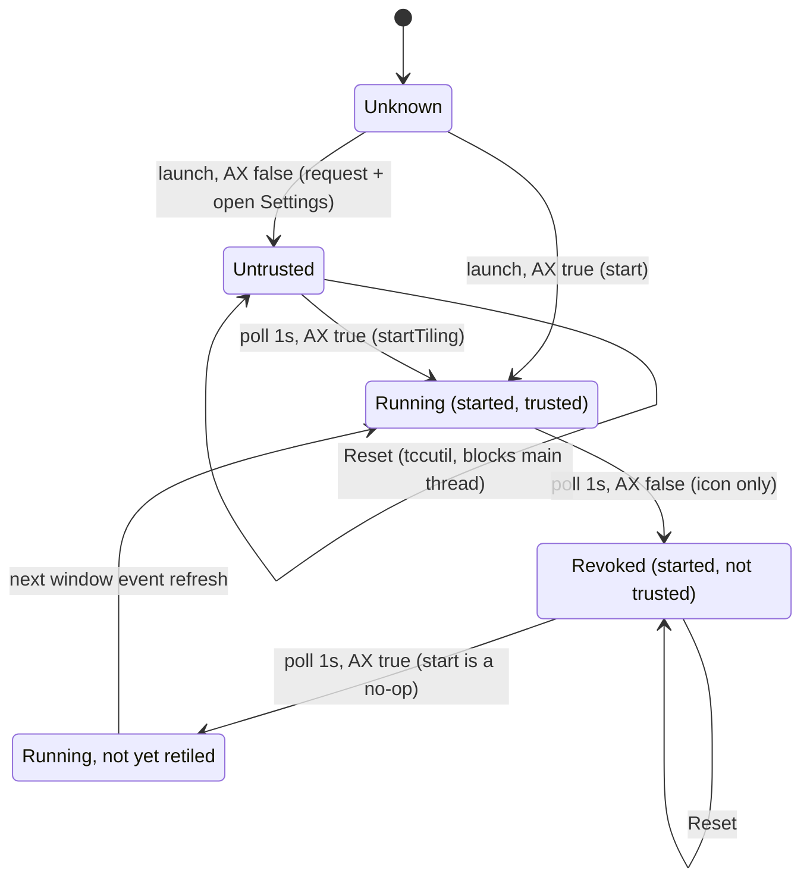

---

### M2. Tiling on / paused

**State.** `Config.enabled` is persisted (`Core/Config.swift:78`). `TilingManager.isEnabled` mirrors it (`TM:10`, set in `init` at `TM:79`, in `start()` at `TM:86`, and in `setEnabled` at `TM:102-114`). `AD.started` gates whether config changes reach the manager (`AD:118`). The Settings copy `SettingsModel.config.enabled` waits 0.3 s before saving (`SV:10,120-130`).

**Transitions.**
- `toggle-tiling` command, menu "Tiling On/Off", or URL → `configStore.update { enabled = !isEnabled }` (`TM:757-760`) → `onChange` → `AD.configChanged` → `manager.configDidChange` → `setEnabled` (`TM:117`) → flash "Tiling on" / "Tiling off" (`TM:112`).
- Dashboard switch (`SV:702`) or General toggle (`SV:275`) → wait 0.3 s → `store.update` → the same path.
- Config file edit → watcher (1 s) → the same path.
- Turning off runs `unparkAll()`, which also **resets every workspace assignment** (`TM:476`), clears `targetFrames`, and hides the outline and badges (`TM:106-110`).
- Any other command while off → flash "Tiling is off" (`TM:762-765`).

**Edge states.**
- Per-display "off": layout `.float` ("Float (Off)", `Core/Layout.swift` displayName). The Dashboard card says "Tiles leaves this display alone." (`SV:749`).
- Dashboard header reads `model.config.enabled` (`SV:694-697`). The menu reads `manager.isEnabled` (`AD:192`). They disagree during the 0.3 s debounce, while not trusted, and when the config write fails.
- Config write failure: `ConfigStore.update` sets the in-memory config, then `try? data.write` (`CS:55-57`). Tiling toggles for this session but the next launch reverts. **Silent.**
- Turning tiling off then on loses which window was on which workspace. All windows come back on workspace 1 (`TM:476`).

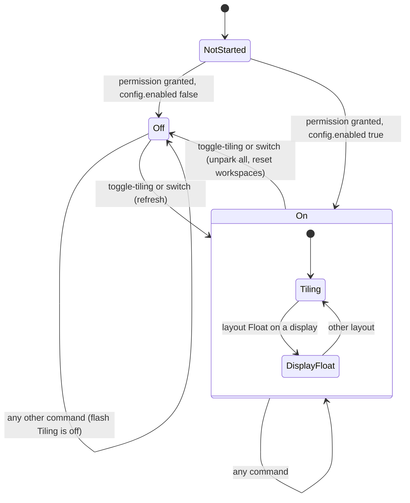

---

### M3. Config file health (load, hot reload, parse error)

**State.** `config`, `lastError: String?`, `lastModified: Date?`, and a 1 s mtime poll (`CS:11-16,69-75`).

**Transitions.**
- Init: `ensureFileExists()` (writes defaults; failure silent, `CS:26-33`) → `load()` → `watch()` (`CS:18-22`).
- mtime changed → `load()` → `onChange(self.config)` (`CS:71-73`).
- `load()` succeeds → `config` replaced, `lastError = nil` (`CS:40-42`).
- `load()` fails → `lastError` set, **`config` keeps the last good value** (`CS:43-48`). `onChange` still fires with the old config. `AD.configChanged` flashes "Config error" and `NSLog`s it (`AD:121-124`).
- `update(_:)` (every menu toggle, Settings save, gaps, toggle-tiling) → writes the **whole in-memory config** over the file and sets `lastModified` (`CS:52-61`). It **does not clear `lastError`**.

**Error and edge states.**
| Edge | What the user sees | Evidence |
|---|---|---|
| Invalid JSON / wrong type / unknown enum value (e.g. `"defaultLayout": "dwindel"`) | 1.6 s flash "Config error" (5 s if longer), plus a disabled menu item `⚠︎ Config: <decoder text>`. **Nothing in the Settings window.** | `AD:121-123,274-278`; `CS:77-89` |
| Invalid config at launch | Menu item only. No flash (no change event at launch). Tiles runs on defaults. | `CS:11,18-21` |
| **Broken file silently overwritten** (likely bug, verify): while the file is invalid, any Settings edit or menu toggle calls `update`, which writes the last good config over the user's hand edits | Nothing. The user's edits are lost | `CS:52-57`; `SV:120-127` |
| **Stale error** (likely bug, verify): after that overwrite, `lastError` stays set and the watcher skips the reload (mtime matches `lastModified`), so the menu keeps showing `⚠︎ Config: …` for a valid file until it is edited again | stale warning | `CS:52-61,71` |
| File deleted while running | "Config error" flash. Menu shows the Foundation "couldn't be opened" text. The file is only recreated by "Edit Config File…" or the next `update` | `CS:36-47`; `AD:424` |
| Valid JSON, out-of-range values (`masterRatio: 5`, `outlineColor: "#E8643"`) | Accepted without checks (`Core/Config.swift:211-234`). An invalid outline hex **silently hides the outline** (`FO:25-28`) | — |
| Pending Settings change while an external edit arrives | `AD:120` replaces `model.config`. The pending 0.3 s save then sees `config == store.config` and drops the user's in-flight change | `AD:120`; `SV:123` |

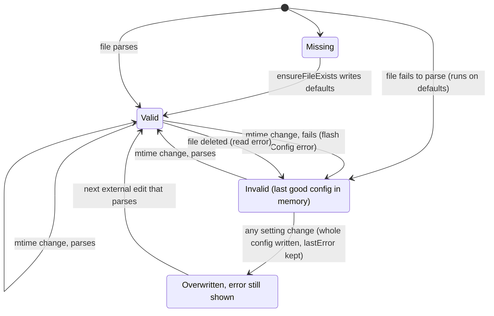

---

### M4. Settings autosave

**State.** `@Published config { didSet { scheduleSave() } }` (`SV:10`); `saveWork` with a 0.3 s debounce (`SV:43,120-130`); `lastSaved: Date?` (`SV:34`); subtitle "All changes saved" once `lastSaved != nil` (`SV:249`).

**States.** `Clean (never saved)` → `Pending (0.3 s)` → `Saved`. There is no `Saving` state and no `Failed` state.

**Edge states.** The write can fail silently (`CS:56-57`), yet the subtitle still says "All changes saved". The subtitle never goes back to "unsaved" once set. If the config file is invalid (M3), the subtitle claims success while the save overwrites the user's file. "Restore All Defaults…" (`SV:329-331`) asks for confirmation but has no undo.

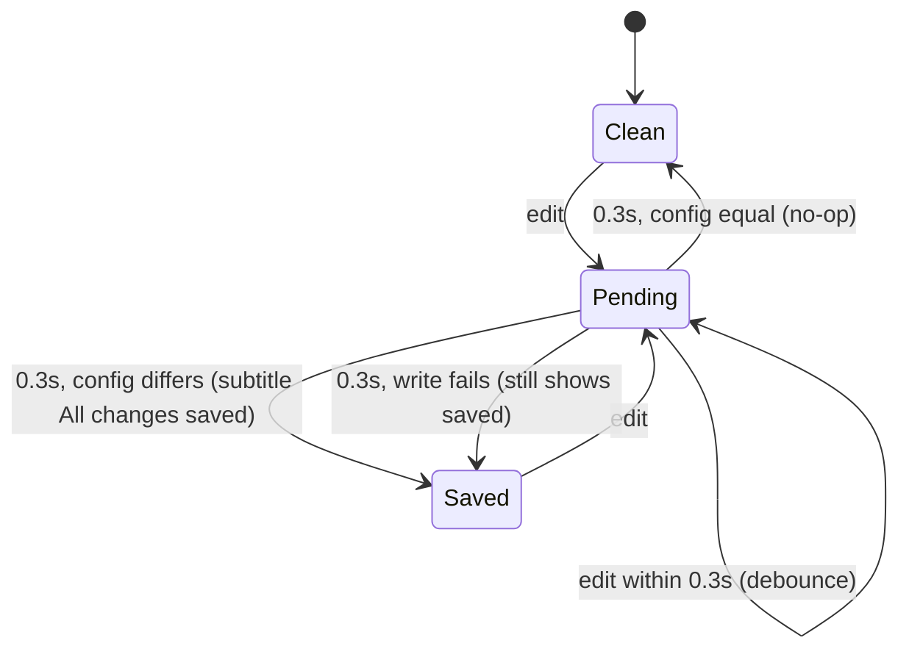

---

### M5. Profiles: save, apply, delete, import, export

**State.** None beyond `profiles: [String]` (`SV:35`). Files live in `~/.config/tiles/profiles/*.json` (`SV:75-85`).

**Per-operation outcomes.** Every failure is swallowed with `try?` or `guard … else { return }`:
| Op | Outcomes | Evidence |
|---|---|---|
| Save | success / **name collision silently overwrites** / write failure silent | `SV:87-92` (`.atomic` write, no exists check) |
| Apply | replaces the **entire** config (including `enabled`, hotkeys, rules), no confirm, no undo / decode failure silent | `SV:94-97` |
| Delete | no confirm / failure silent | `SV:99-102`; `SV:824` |
| Export | cancelled and failed look the same; success shows nothing | `SV:104-110` |
| Import | invalid JSON → silent no-op / valid → whole config replaced, no confirm | `SV:112-118` |

Name sanitising only maps `/` to `-` and trims whitespace (`SV:78`), so "Desk" and "Desk " map to the same file. Nothing records which profile is active.

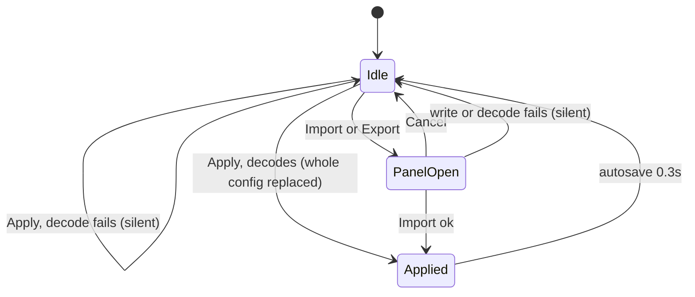

---

### M6. Updater

**State.** `available: String?`, `status: String` (free text), a 24 h `timer` (`UP:10-13`). There is no in-flight flag.

**Transitions.**
- `setAutomatic(true)` → `check()` now and every 24 h (`UP:18-24`). Called at launch (`AD:44`) and when the setting changes (`AD:117`).
- `check()` → status "Checking…" → GET `api.github.com/…/releases/latest` (`UP:26-30`) → on main:
  - newer → `available = v`, "Tiles v is available";
  - not newer → `available = nil`, "Tiles is up to date";
  - no `tag_name` → `available = nil`, "Couldn't reach GitHub" (`UP:35-41`).
- `install()` → "Downloading Tiles v…" → download, unzip, `codesign --verify` against team `GQ638955FB` (`UP:48-64`). On failure: "The update couldn't be downloaded or verified" (`UP:67-70`). On success: spawn the swap script and `NSApp.terminate` (`UP:73-79`).

**Error and edge states.**
| Edge | What the user sees | Evidence |
|---|---|---|
| Offline, HTTP 403 rate limit, 404, or bad JSON | all collapse to "Couldn't reach GitHub". HTTP status is ignored | `UP:30-40` |
| Download failed vs signature failed | one combined message | `UP:58-68` |
| `check()` during a download (Check Now, 24 h timer, toggling the setting) | status overwritten with "Checking…" and `available` may change mid-install. The install still terminates the app when done | `UP:26-28`; no guard |
| Repeated "Check Now" / "Install" clicks | parallel requests, no disabled state | `SV:315-318` |
| Swap script cannot run (`try? swap.run()`) | the app **terminates and does not reopen** | `UP:78-79` |
| `rm -rf` succeeds but `mv` fails (permissions, translocated or read-only location) | the app may be **deleted** and the reopen fails, with no UI (the app already quit) | `UP:75-77` |
| Update available | General pane button, plus menu item "Update to Tiles v…" (`AD:187-190`). **No icon badge or notification** | — |
| Downloading | General pane text only. **The menu shows nothing**, no progress | `UP:51` |
| Check failed | General pane only. **The menu shows nothing** | — |
| Strings | not localised (`UP:27,37,40,51,68`) | — |

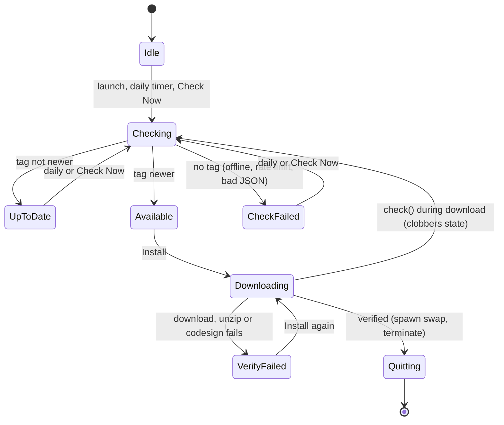

---

### M7. Menu bar flash message

**State.** `statusItem.button.title` and `messageWork: DispatchWorkItem?` (`AD:14,164-170`).

**Transitions.** `flash(text)` cancels the pending clear, sets the title, and schedules a clear after **1.6 s** (≤ 24 chars) or **5 s** (> 24 chars) (`AD:169`). A newer flash always replaces an older one.

**Callers (the only feedback channel for all of these):** "Tiling on/off" (`TM:112`), "Tiling is off" (`TM:763`), "Config error" (`AD:122`), "Couldn't change login item" (`AD:363`), "Unknown command: x" (`AD:90`), "Scene saved" (`TM:852`), "No scene saved for these displays" (`TM:1057`), "Restored … · N windows · ⌃⌥Z to undo" (`TM:1083`), "Nothing to undo" / "Undone" (`TM:895,904`), "Workspace n" (`TM:447,454,468`), "Sent to workspace n" (`TM:919`), "Stacked · click the badge to flip" (`TM:707`), "Floating" / "Tiled" (`TM:1005,1012`), "Retiled" (`TM:833`), layout name (`TM:949`), width preset (`TM:866`), "Widths work in the Scrolling layout" (`TM:859`), "Centre works on floating windows and in Scrolling" (`TM:885`).

**Edge states.**
- **Dock-only placement hides every flash.** `statusItem.isVisible = placement != .dock` (`AD:405`), so errors such as "Config error" and "Tiling is off" are never seen. (Likely UX bug.)
- No severity: an error can be replaced within milliseconds by an info message (e.g. "Restored …" followed by a "Workspace n" focus flash).
- The timeout depends on character count, not reading time or severity.
- **Not localised.** `flash` bypasses `NSLocalizedString`, and none of these strings are in `Resources/Localization/*/Localizable.strings`.
- From the Settings window, flash feedback for Dashboard buttons appears far away in the menu bar (`SV:770-775`).

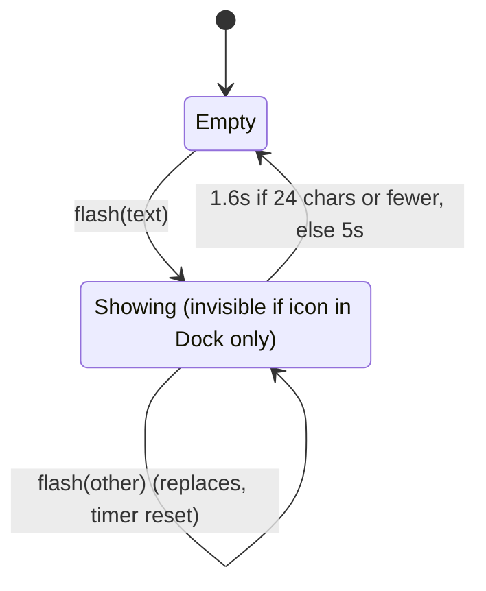

---

### M8. Status icon (derived)

`updateIcon()` (`AD:150-162`): untrusted → `exclamationmark.triangle`; else enabled → `rectangle.split.2x2`; else `rectangle.dashed`. It is recomputed on permission change, after every refresh (`TM:273` via `onStateChange`), and on config change.
**Missing states:** config error, update available, update failed, hotkey conflicts, display settling. None of these change the icon.

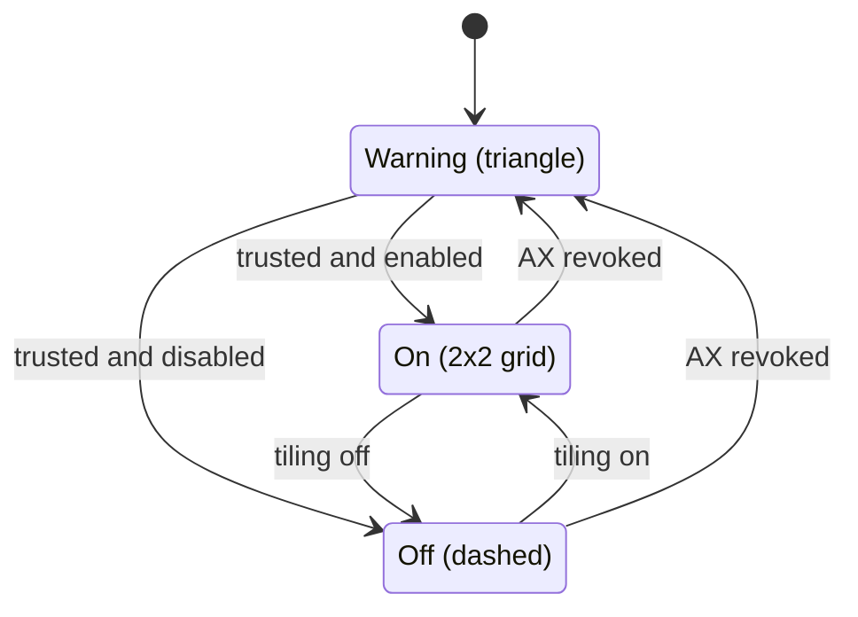

---

### M9. Launch at login

**State.** `SMAppService.mainApp.status`, collapsed to `== .enabled` (`AD:267`; `SV:31,143`). There are two separate writers: the menu (`AD:358-366`, flashes on error) and Settings (`SV:140-144`, `try?` silent, re-reads status afterwards).

**Edge states.** `.requiresApproval` (the user must allow Tiles in System Settings › General › Login Items) shows as **off**, with no explanation. `.notFound` (not in /Applications, dev build) makes `register()` throw: the menu shows "Couldn't change login item", **while Settings silently flips the toggle back**. `SettingsModel.launchAtLogin` is read once per window open (`SV:31`), so it goes stale if changed in System Settings.

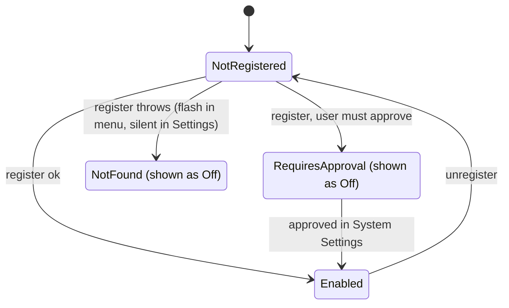

---

### M10. Scenes: autosave, restore, undo

**State.** `autosaveWork` (3 s debounce, `TM:29,1018-1027`); `autosaveBlockedUntil` (now + 20 s at start `TM:99`, now + 8 s after a display-set change `TM:161`); `undoSnapshot` (`TM:34`); `scenes.json` read from disk on every use (`TM:37-41,1045,1051,1056`); `config.autoRestoreScenes` gates **both** autosave (`TM:1019`) and auto-restore (`TM:97,166`).

**Transitions.**
- A structure change in refresh, swap, promote, move, layout, ratio or undo → `scheduleAutosave()` → after 3 s: if `now > blockedUntil` and visible windows exist → `saveScene()` (`TM:1021-1024`).
- `save-scene` → `saveScene()` then flash "Scene saved" (`TM:850-852`). The flash shows **even if the write failed** (`try? store.write`, `TM:1047`).
- `restoreScene(silently:)` → refresh → no scene: flash "No scene saved…" (only when not silent) → else `undoSnapshot = (orders, layouts, parameters)`, apply, flash "Restored X · N windows · ⌃⌥Z to undo" (`TM:1054-1083`). Silent restores also flash "Restored…".
- `undo-restore` → snapshot restored, `undoSnapshot = nil`, flash "Undone". No snapshot → "Nothing to undo" (`TM:893-904`).

**Error and edge states.**
| Edge | What the user sees | Evidence |
|---|---|---|
| `scenes.json` corrupt or unreadable | `load` silently returns an empty store (`Core/Scene.swift:53-58`). The **next autosave overwrites the file, losing every scene** | `TM:1045-1047` |
| Write fails | "Scene saved" flash anyway / autosave silent | `TM:1047,852` |
| Delete scene in Settings fails | silent | `SV:158-163` |
| Turning off "Restore scenes when displays change" | **also stops autosave** (an unexpected coupling) | `TM:1019` |
| Restore with 0 matching windows | "Restored laptop · 0 windows · ⌃⌥Z to undo", and a snapshot is still created | `TM:1066,1083` |
| Undo snapshot lifetime | never expires. It survives display changes and later edits. "Undo Scene Restore" stays at the top of the menu indefinitely (`AD:182-185`). Undo after other edits throws those edits away | `TM:34,898-903` |
| Stacks, zoom, workspaces, scroll widths | not part of scenes or the undo snapshot | `Core/Scene.swift:5-18`; `TM:1066` |
| Dashboard "Restore Scene" with no scene | button enabled; flash only. The menu item is disabled (`AD:243-245`) | `SV:765` |
| Settings "Save Current Scene" while tiling is off | "Tiling is off" flash in the menu bar | `SV:505`; `TM:762` |

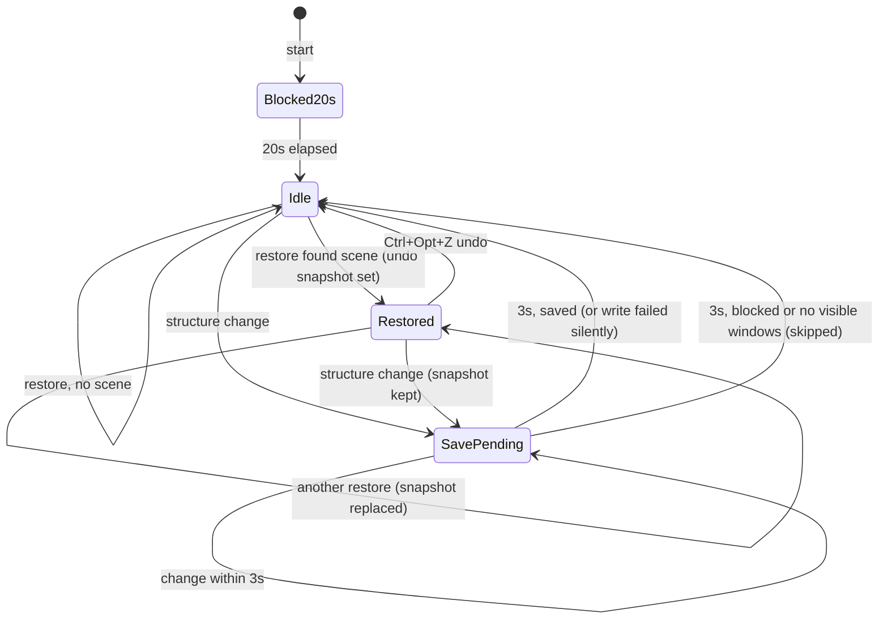

---

### M11. Display settle after dock/undock

**State.** `displays` (snapshot from the last refresh, `TM:11,193`); `displayWork` (1.0 s, `TM:30,162-170`); `autosaveBlockedUntil` (8 s).

**Transitions.** `didChangeScreenParameters` (`WO:138-140`) → `displaysChanged()`:
- same set of display IDs → `scheduleRefresh()` (30 ms) (`TM:156-158`);
- different set → cancel pending autosave, block autosave for 8 s, cancel prior settle, then after **1.0 s** `refresh()` and (if `autoRestoreScenes`) `restoreScene(silently: true)` (`TM:160-170`).

**Edge states.**
- **Restore while off or untrusted (likely bug, verify).** The settle block is not gated by `isEnabled` or trust. `refresh()` returns early (`TM:192`), so `displays` is stale (the *previous* set). If that set has a scene, `restoreScene` still sets `undoSnapshot`, rewrites `orders`/`layouts` and flashes "Restored … ⌃⌥Z to undo" while tiling is off (`TM:166,1054-1083`). The same happens at `start()` (`TM:97`).
- Zero displays (lid closed, display asleep): `refresh()` returns early (`TM:194`). Nothing is shown.
- 1.0 s may not be enough for some docks. There is no retry or second pass.
- No "Arranging for LG UltraFine…" indication during the settle.

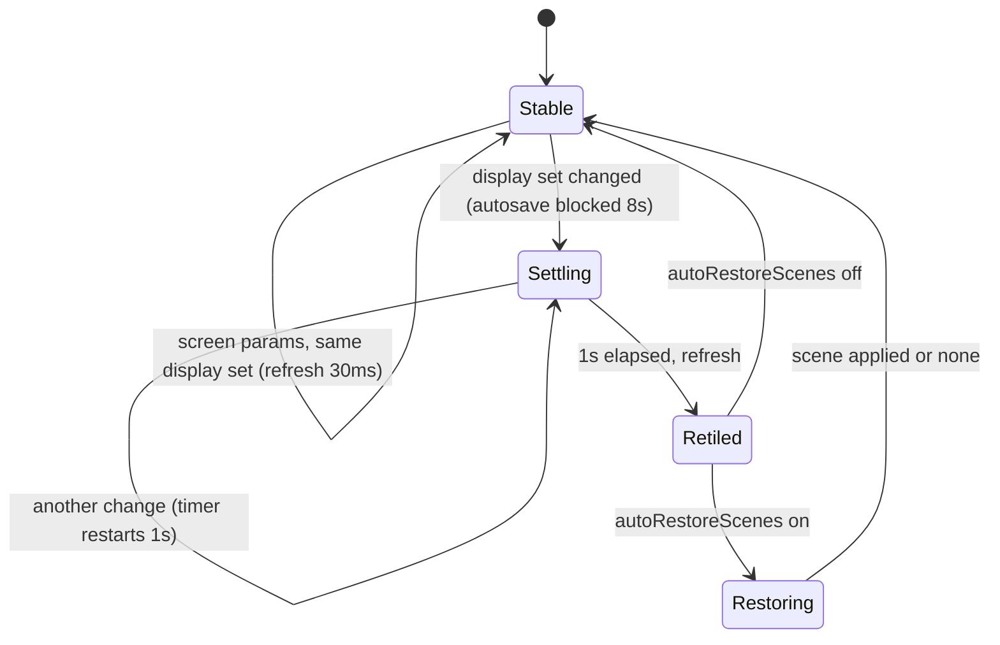

---

### M12. Mouse: user drag vs resize vs Tiles' own move

**State.** `ignoreMovesUntil` (now + 0.5 s after Tiles moves windows `TM:340`; now + 0.18 + 0.5 s when animating `TM:415`); `trackedWindow: WindowID?` (`TM:32`); `mouseTimer` (50 ms poll, `TM:31,594-602`); live `NSEvent.pressedMouseButtons` and `modifierFlags`; `config.dragToSwap`, `config.resizeToAdjustRatio`.

**Transitions.**
- `frameChanged` when enabled, past `ignoreMovesUntil`, not tracking, left button down, and the window is tiled → hide the outline, start tracking (`TM:143-150`).
- Mouse up (50 ms poll) → `finishUserChange()` (`TM:604-635`), which classifies:
  1. size differs by more than 2 pt → **Resize**: `adjustRatio` if `resizeToAdjustRatio` (Master & Stack, Wide Master, Dwindle index 0-1, Centered Master, Scrolling width). Otherwise, or in other layouts, it snaps back (`TM:612-616,638-688`);
  2. `dragToSwap` off → snap back (stack membership kept) (`TM:617`);
  3. Option held and over another tile → **Stack** (`TM:622-626`);
  4. over another tile that isn't the former host → **Swap** (`TM:629-630`);
  5. on another display → **Move** (`TM:631-632`);
  6. otherwise → **Unstack / snap back** (`TM:628`).
  Then `refresh()` (deferred) and `scheduleAutosave()`.

**Edge states (none have UI).** Resize in Columns, Rows, Grid, Thirds or Monocle snaps back silently (README:154 documents this). A drag that starts within 0.5 s of a Tiles move is ignored until the window passes. No drop-target preview (swap vs stack vs move). Dragging onto a display with the Float layout appends the window to that display's order, where it stays untiled.

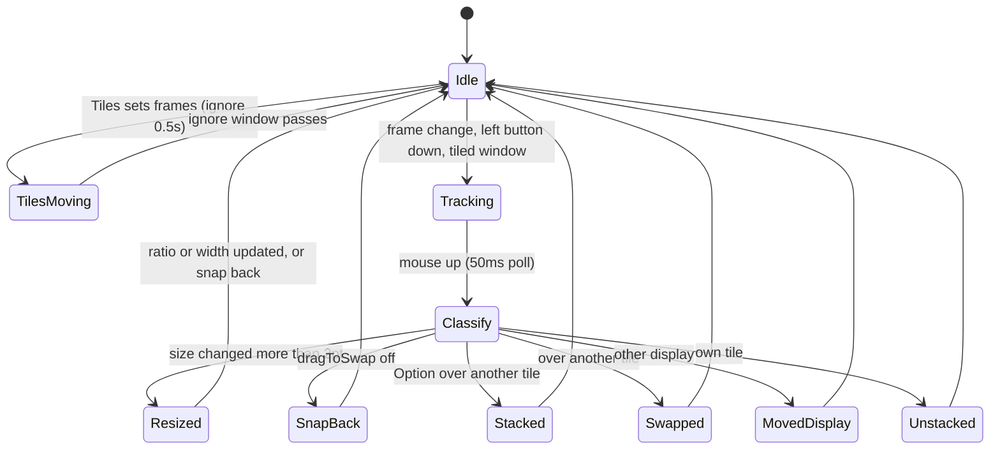

---

### M13. Window animation

**State.** `animation: (start, moves)?` and a 60 Hz `animationTimer`, lasting 0.18 s with ease-out (`TM:74-75,395-433`). It runs only if `config.animateWindows`, nobody is panning, every move is a tiled move, and there are ≤ 8 moves (`TM:343`). Otherwise it jumps (`TM:346-347`). A new `apply` interrupts the running animation and starts from the interpolated frame (`TM:335`). `unparkAll` stops it (`TM:473`). No UI is needed.

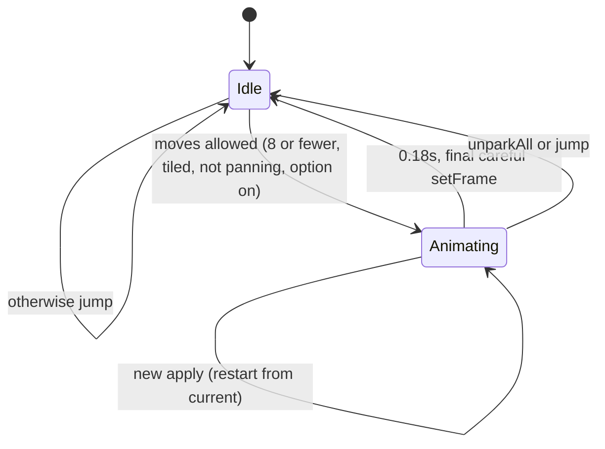

---

### M14. Focus mode ("zoom", ⌃⌥M)

**State.** `zoomed: WindowID?` (`TM:54`).

**Transitions.** `toggle-zoom` on the focused tiled window: if it is already zoomed → nil, else → that id (it can jump straight from window A to window B) (`TM:888-891`). In `apply`, if the zoomed window has no target (closed, floated, sent to a hidden workspace, display set to Float, minimised) → `zoomed = nil` (`TM:311-315`). The zoomed window is raised on every apply (`TM:352-354`).

**Edge states.**
- **No UI at all.** Toggling doesn't flash (unlike every other command). There is no menu checkmark and no Dashboard indicator; `status()` reports the zoomed frame, so the card shows one tile covering the others (`TM:969-972`).
- Nothing focused → silent no-op (`TM:889`).
- Tiling off does not clear `zoomed`, so zoom can come back when tiling is turned on again (`TM:102-111`).

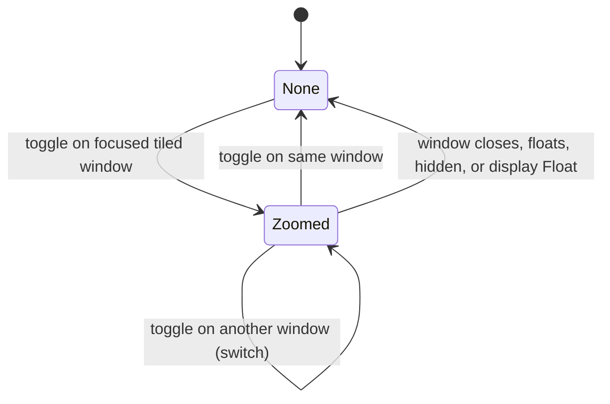

---

### M15. Workspaces and parking

**State.** `Workspaces.active[display]` (missing means 1) and `assigned[window]` (`Core/Workspaces.swift:8-10`); `parked: [WindowID: Rect]` (frame to restore, `TM:63`); `lastWorkspaceSwitch` (0.6 s focus guard, `TM:64,463`); `lastFocused` (`TM:66`).

**Per-window states.** `Shown` / `Parked` (moved to the display's bottom corner with 1 pt on screen, `TM:319-329`) / `NotVisible` (minimised or hidden app).

**Transitions.**
- `workspace-n` on the active display: same n → flash only; else show, refresh, focus first, flash (`TM:444-455`).
- `move-to-workspace-n`: unstack the window and its guests, refresh, focus neighbour, flash "Sent to workspace n" (`TM:909-919`).
- Focus lands on a parked window (⌘-Tab or Dock), more than 0.6 s after the last switch and with the focused window changed → switch the display to that workspace (`TM:460-469`).
- Tiling off or quit → `unparkAll()`: all windows come back **and all assignments are forgotten** (`TM:472-477`; `AD:80`).

**Edge states.**
| Edge | What the user sees | Evidence |
|---|---|---|
| **Undocking hides windows (likely bug, verify).** Windows on a removed display keep `assigned = k`. On the remaining display they are treated as new, but `adopt` keeps k (`Core/Workspaces.swift:25-27`). If that display shows a different workspace, they are **parked off screen** right after undocking | windows "vanish"; only ⌘-Tab or a workspace switch brings them back | `TM:223-242,265`; `Core/Workspaces.swift:20-27` |
| Crash or force-quit while windows are parked | windows stay 1 pt on screen until Tiles runs again (`applicationWillTerminate` doesn't run) | `TM:63` (memory only); `AD:77-81` |
| ⌘-Tab to a parked window within 0.6 s of a switch | focus goes to an off-screen window; no switch | `TM:463` |
| Tiling off then on | every window lands on workspace 1 | `TM:476` |
| How many windows are hidden where | menu "•" marks occupied workspaces (`AD:219`). The Dashboard picker appears only if more than 1 workspace is occupied (`SV:731`). Hidden windows are **never listed** | — |

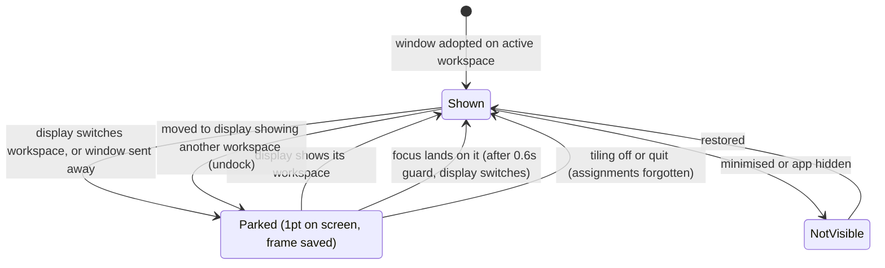

---

### M16. Stacks

There are **two kinds of stack, shown with one badge**:
1. Explicit (Option-drag): `stackedOn[guest] = host` (`TM:68,694-708`).
2. Implicit overflow and Monocle: windows beyond `maxTiles` share the last frame (`Core/Layout.swift:113,145`). Monocle gives every window the same frame.
`reportStacks()` groups visible windows by identical target frame, fully on screen (`TM:361-374`). `StackBadges.show` reuses panels and sets each one's count (`SB:11-31`).

**Transitions.** Option-drop → stack (guests of the dragged window move to the new host) with flash "Stacked · click the badge to flip". Plain drag → unstack (`TM:628`). Send to workspace → unstack the window and its guests (`TM:915-916`). Host or guest closes → pruned (`TM:268`). Badge click → focus the next window after the top one (`TM:548-551`). Tiling off → badges cleared (`TM:110`).

**Edge states and contradictions.** `stackedOn` can point to a host on another display or workspace (e.g. after `move-to-next-display` of the host, `TM:840-848`). The guest then gets its own tile (`TM:294`), and the stale link comes back if the host returns. Stacks are not in scenes or undo. The badge doesn't say which window is on top. Its tooltip is not localised (`SB:22`). The Settings footer tells users to flip with ⌃⌥N (`SV:393`), while the badge says "click".

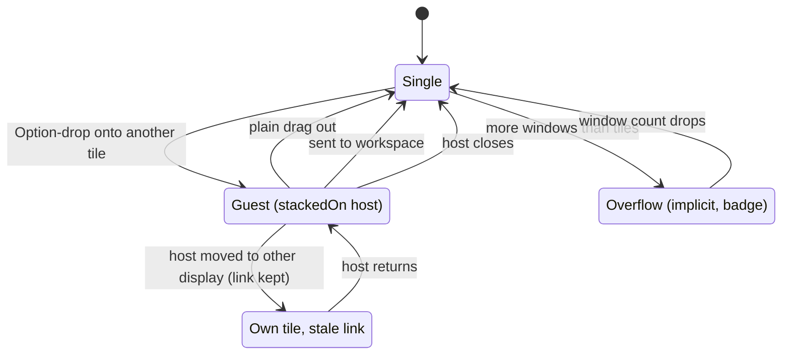

---

### M17. Shortcut recorder

**State.** Per-row `@State recording`, `@State monitor` (`SV:962-963`). A global notification `.tilesShortcutRecording` true/false (`SV:984,1001,1007`) → `hotKeys.unregisterAll()` / `registerHotKeys()` (`AD:50-52`).

**Transitions.** Click → Recording: **all global Tiles shortcuts are unregistered**. Esc → Idle. A key with a known keycode and at least one modifier → `onChange` + stop (`SV:985-993`). Any other key → **swallowed, stays recording, no feedback** (`SV:988,992,1011-1019`). Row disappears → stop (`SV:978`).

**Edge states.**
| Edge | Evidence |
|---|---|
| Two rows recording at once: each start posts `true`; the first stop posts `false` and re-registers hotkeys while the other row is still recording | `SV:981-1002` |
| App loses focus while recording: local monitors receive nothing, global shortcuts stay off, and only the button label shows it | `SV:985` |
| A key without a modifier, or an unknown key: silently ignored | `SV:1012,1019` |
| A shortcut used by another Tiles command is silently taken over (`bind` sets the others to `"none"`) | `Core/Config.swift:359-366` |
| Shift-only shortcuts accepted (e.g. ⇧A), which would block typing a capital A system-wide | `SV:1019`; `Core/Command.swift:134` |
| A shortcut taken by another app is reported **only in the menu** (M18), not in the row | `AD:143` |

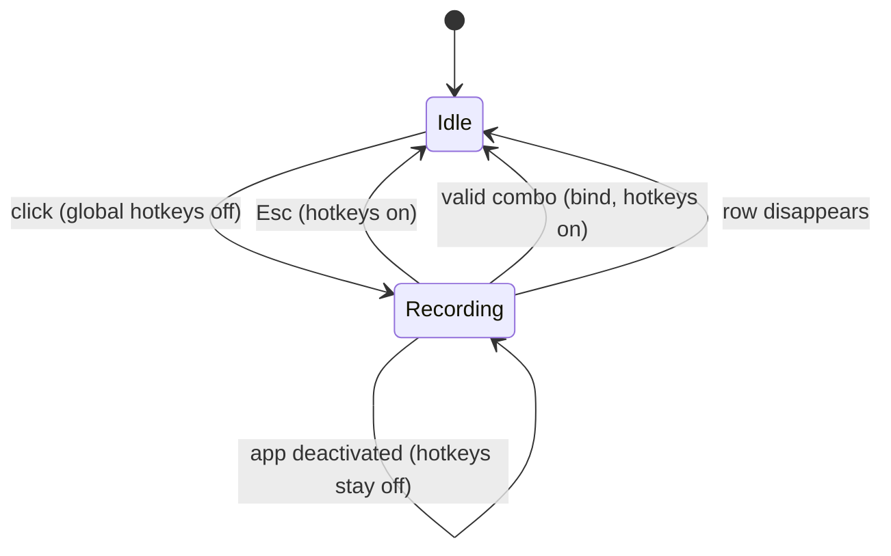

---

### M18. Hotkey registration errors

**State.** `hotkeyErrors: [String]` (`AD:12`), rebuilt on every config change and every recorder stop (`AD:136-146`). The errors are "Unknown shortcut", "Unknown command", and "<shortcut> is taken by another app" (`Core/Config.swift:296-302`; `AD:143`). A duplicate shortcut is silently ignored (`Core/Config.swift:304`). **UI: only the first 3, as disabled menu items** (`AD:279-283`). Nothing appears in the Shortcuts pane, icon or Dashboard.

---

### M19. Scroll-to-pan (Scrolling layout)

**State.** `panning: Set<displayID>`, `panWork` (1/60 s coalescer), `panEndWork` (0.35 s idle), `scrollOffsets`, `scrollTap` (`TM:57,70-73`).

**Transitions.** A ⌃⌥ scroll (no ⌘) over a Scrolling display → offset += delta, mark panning (the strip stops following focus), coalesce `apply` at 60 Hz (`TM:504-531`). After 0.35 s without scrolling → `finishPan`: focus the window nearest the centre (`TM:535-543`). If the tap is disabled by timeout or user input, it re-enables itself (`TM:489-491`).

**Edge.** Tap creation failure is silent and never retried (`TM:495-497`). Animation is suppressed while panning (`TM:343`).

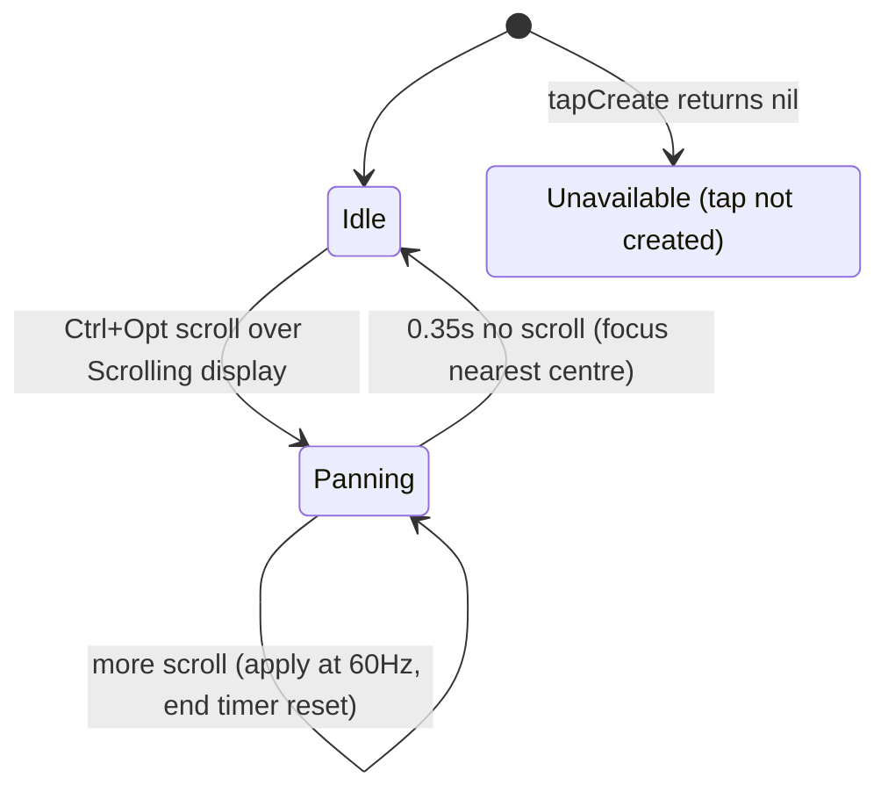

---

### M20. Per-window float/tile override

**State.** `userFloating`, `userTiled` (`TM:18-20`). Resolution order: userFloating → userTiled → rules (`TM:585-590`).
**Per-window states:** `RuleDefault`, `UserFloating`, `UserTiled`. `toggleFloat` keeps the two sets disjoint (`TM:996-997,1007-1009`), but they are never pruned when windows close and never persisted.
**UI:** "Floating" / "Tiled" flash only. The Dashboard never shows floating windows and no list exists.

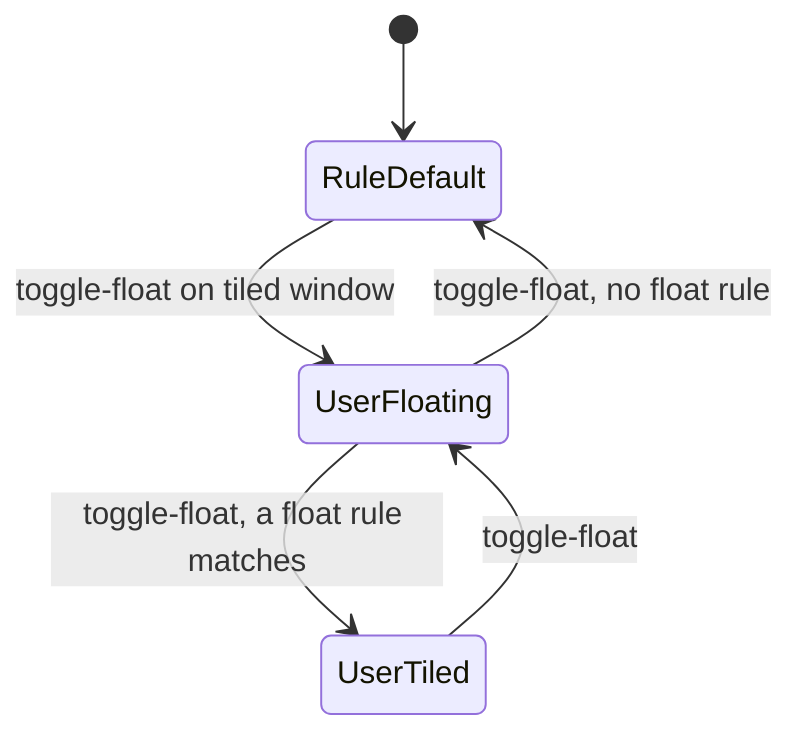

---

### M21. Per-display layout source

**State.** `layouts[display]` and `parameters[display]` are runtime overrides (`TM:15-16`). They are filled lazily from config (`TM:255-260`), replaced by the menu, Dashboard, hotkeys and scene restores (`TM:945-951,1072-1076`), and **wiped** when `defaultLayout`, `ultrawideLayout` or `displays` change in config (`TM:120-122`). Parameters are re-merged per field (`TM:123-128`).
**Contradiction.** Settings › Layouts › "Connected displays" writes `config.displays` (`SV:354-365`), while the menu picks a runtime layout that config never sees. A menu-picked layout survives only through scenes. Changing the *default* layout in Settings silently throws away every menu-picked layout.

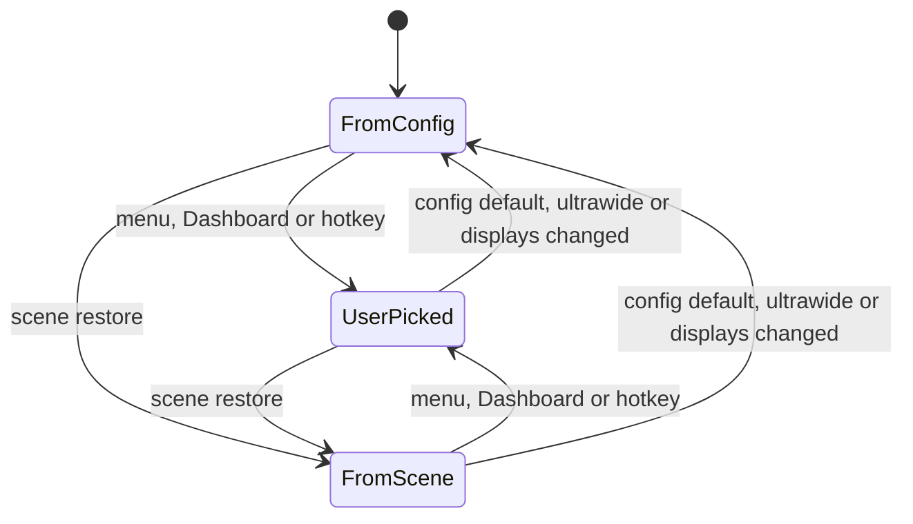

---

### M22. Settings window, icon placement, activation policy

**State.** `settingsWindow`, `settingsModel` (`AD:19-20`), `config.iconPlacement`, the activation policy, and `statusItem.isVisible` (`AD:403-408`).
**Matrix.** placement {menuBar, dock, both} × window {open, closed} → policy `.regular` unless (menuBar and closed) → `.accessory`. Status item visible unless `dock`.
**Edge.** Closing the window does not release `settingsModel`, whose 1 s `liveTimer` keeps calling `status()` until the next open replaces it (`SV:63-71`; `AD:379`). In `dock` mode the flash channel (M7) disappears. The Dock right-click menu mirrors the status menu, including warnings (`AD:411-415`).

```mermaid
stateDiagram-v2
    [*] --> Accessory
    Accessory --> RegularWindow : open Settings
    RegularWindow --> Accessory : close, placement menu-bar
    RegularWindow --> Regular : close, placement dock or both
    Regular --> RegularWindow : open Settings
    state "Accessory (menu bar only)" as Accessory
    state "Regular, window open" as RegularWindow
    state "Regular (Dock icon)" as Regular
```

---

### M23. Dashboard display card (derived)

`status()` (`TM:965-980`) + card (`SV:724-759`). Card states: tiles shown / "No windows on this display." / "Tiles leaves this display alone." (Float).
**Misleading states:**
- Tiling paused → `targetFrames` cleared (`TM:108`) → every card says "No windows on this display." while the header says "Tiling is paused".
- Not trusted / not started → `manager.displays` empty → `Display.current()` with no tiles → "No windows…" beneath the permission banner.
- Focus mode → one tile covers the others (M14).
- Windows on hidden workspaces aren't counted in "Tiling N windows" (`SV:673,696`).

```mermaid
stateDiagram-v2
    [*] --> Tiles
    Tiles --> Empty : no tiled windows
    Empty --> Tiles : windows open
    Tiles --> FloatDisplay : layout Float
    FloatDisplay --> Tiles : other layout
    Tiles --> EmptyMisleading : tiling paused or no permission
    EmptyMisleading --> Tiles : tiling on and trusted
    state "Shows No windows (wrong reason)" as EmptyMisleading
```

---

### M24. App observation and AX failures (no state, no UI)

- `AXObserverCreate` failure → that app is silently never observed (`WO:40`).
- Frozen app → 0.5 s messaging timeout per app (`WO:37`; `TM:205`). Its windows just don't move.
- An app's first window appears late → one retry after 0.6 s (`WO:127-132`).
- `setFrame` ignores AX return codes (`AX:77-79,138-140`). A window with a minimum size larger than its tile never fits and is re-sent on every refresh. Nothing reports it.
- Native full-screen windows, other Spaces and Stage Manager are excluded or unsupported (`TM:214`; README:276). No UI explains why a window isn't tiled.

---

### M25. Focus-follows-mouse hover

`hovered: WindowID?` (`TM:52,553-562`). Hovering a new tiled top window focuses it. Leaving tiled windows resets it. Fine without UI.

### M26. First-run onboarding

`UserDefaults "didShowSettings"` (`AD:103-106`). When untrusted on first launch, Settings is opened by the permission path (`AD:63`). When trust arrives, `startTiling` opens Settings again, which just brings it to the front. There is no onboarding beyond the Dashboard banner.

### M27. Quit, restart, restore frames

`applicationWillTerminate`: only if `started` → `restoreOriginalFrames()` (default) or `unparkAll()` (`AD:77-81`). `originalFrames` is the frame at first sight (`TM:213`); for a window first seen while parked, that is the parked frame. "Restart Tiles" and update install both go through terminate, so windows jump back to their original frames and then re-tile. In the `restoreWindowsOnQuit` path, `parked` isn't consulted separately because parked windows are in `windows`.

---

## 3. Contradictions the current representation allows (cross-machine)

1. Menu "Tiling On ✓" and green Dashboard dot while Accessibility is revoked (M1 × M2): `AD:192`, `SV:694`.
2. `Config.enabled` vs `manager.isEnabled` vs `SettingsModel.config.enabled`: three copies with different update timing (M2/M4).
3. Valid file with a stale `lastError` showing; or invalid file plus "All changes saved" (M3 × M4).
4. Tiling off with a scene "Restored … ⌃⌥Z to undo" flashed (M2 × M10 × M11).
5. `zoomed` set while tiling is off; it reappears when tiling comes back (M14 × M2).
6. `stackedOn` linking windows on different displays or workspaces (M16 × M15).
7. Two shortcut recorders recording at once; global hotkeys re-enabled while one is still recording (M17).
8. Updater `available == nil` while `status == "Downloading…"` after a concurrent `check()` (M6).
9. `userFloating`/`userTiled` hold IDs of windows that no longer exist (M20).
10. Undo snapshot captured for one display set and applied after the set has changed (M10 × M11).

---

## 4. States with **no** user-visible design today

- Config error **in the Settings window** (M3); "your hand edits were overwritten" (M3); settings write failed (M4).
- All profile results: saved, overwritten, applied, import failed, export failed (M5).
- Update downloading or failed **in the menu**; a reason for check failure; install/swap failure (M6).
- Every flash when the icon is Dock-only (M7); flash severity (M7).
- Config error, update or conflict in the **icon** (M8).
- Launch at login "needs approval" / "not available from this location" (M9).
- Scenes file unreadable / scene not saved / autosave paused (20 s after start, 8 s after docking) (M10).
- Displays settling (M11).
- Drag outcome preview: swap, stack, move, ratio change, "snaps back here" (M12).
- **Focus mode on** (M14).
- Windows hidden on other workspaces, especially after undocking (M15).
- Which window is on top of a stack (M16).
- Recorder: "needs a modifier", "replaces Focus Left", "taken by another app", "Tiles shortcuts paused" (M17/M18).
- Scroll-to-pan unavailable (M19).
- List of floating windows (M20).
- "Layout picked from menu, not saved to config" (M21).
- Dashboard card "Tiling is paused" / "Waiting for Accessibility" (M23).
- Window can't fit its tile / app not responding / window not tiled because it's full screen (M24).
- "Restart Tiles to finish turning on access" (M1).

---

## 5. Top error states that need UI design (ranked)

Ranking weighs harm (data loss or silent failure) × frequency × how invisible it is today. Copy follows the app's tone: short, plain, second person, ⌃⌥ glyphs, no jargon.

| # | State | Where to design it | Suggested copy |
|---|---|---|---|
| 1 | **Accessibility missing / revoked / needs restart** (M1). It exists, but revoked-while-running contradicts the "Tiling On" state, and restart is never suggested | Dashboard banner (existing), menu header, icon, Dashboard cards | Banner: "Tiles needs Accessibility access to move windows." · Secondary: "Already switched on? Click Reset, then switch Tiles on again." · After 10 s still untrusted post-grant: "Switched on but nothing moves? Restart Tiles." [Restart] · Card: "Waiting for Accessibility access." |
| 2 | **Config file has an error** (M3). Menu only, overwrite risk | Dashboard banner + General pane row + menu (existing) + icon dot | "Your config file has an error. Tiles is using your last working settings." · Detail: "At layout.masterRatio: Wrong type." · Buttons: [Open Config File] [Use Settings Here] · Warning on edit: "Changing a setting here will replace the file." |
| 3 | **Feedback invisible in Dock-only mode** (M7) | A small HUD/toast near the focused window or screen centre; a severity token for errors | Same strings as today. Errors use a warning style, e.g. "Tiling is off. Press ⌃⌥T to turn it on." |
| 4 | **Windows hidden on another workspace** (M15), incl. after undocking | Dashboard card footer, menu workspace row, flash after undock | "3 windows are on workspace 2." [Show] · After undock: "Brought 3 windows over from LG UltraFine." |
| 5 | **Update failed / downloading** (M6) | General pane row (existing), menu item, optional icon dot | "Couldn't check for updates. Check your connection and try again." · "GitHub is busy right now. Tiles will try again tomorrow." · "Downloading Tiles 1.4…" · "The update couldn't be verified, so Tiles didn't install it." · "Tiles 1.4 is ready. Tiles will restart to finish." |
| 6 | **Shortcut problems** (M17/M18) | Inline in each Shortcuts row; recorder helper text | "Taken by another app." · "Add ⌃, ⌥ or ⌘." · "⌃⌥H was Focus Left. It now does this instead." [Undo] · While recording: "Tiles shortcuts are paused while you record." |
| 7 | **Scenes couldn't be saved or read** (M10) | Scenes pane banner; flash | "Tiles couldn't save the scene." · "Your saved scenes couldn't be read. Tiles started a fresh list and kept a copy." · "No scene saved for these displays yet." · Toggle footer: "Turning this off also stops saving scenes." |
| 8 | **Tiling paused** (M2/M23). Cards currently say "No windows" | Dashboard header + each card; menu | Card: "Tiling is paused. Turn it on to arrange this display." · Action while off: "Tiling is off. Press ⌃⌥T to turn it on." |
| 9 | **Launch at login can't be set** (M9) | General row, menu item | "Allow Tiles in System Settings › General › Login Items." [Open] · "Tiles can only launch at login from the Applications folder." |
| 10 | **Profiles** (M5) | Profiles pane | "Saved “Desk”." · "A profile called “Desk” already exists. Replace it?" · "Apply “Travel”? It replaces all your current settings." · "That file isn't a Tiles settings file." · "Exported to Tiles Settings.json." |
| 11 | **Focus mode on** (M14) | Flash, menu checkmark, Dashboard tile badge | "Focus · Safari fills the display. ⌃⌥M puts it back." |
| 12 | **Window can't fit / not tiled** (M24). Needs detection first | Dashboard card footnote | "Xcode can't shrink to fit its tile." · "Full-screen windows are left alone." |

---

## 6. Recommendation

The first step is this document: it changes no code, so it can't break the build. The steps below follow from it, each shippable on its own.

### Next steps, in order (each separately shippable)

1. **`Package.swift`: guard the `Tiles` target and product with `#if os(macOS)`.** Behaviour-neutral on macOS, where CI builds the same graph. On Linux it should let `swift build && swift test` exercise TilesCore, which would make CI-on-Linux and agent test loops possible. *Untested. Try it on a Linux runner with Swift 5.9+ first.*
2. **Pure reducers in TilesCore for the machines whose logic is pure.** Each is behaviour-neutral if the app keeps calling them with the same inputs, and testable with XCTest on any platform:
   - `UpdaterState` enum (`idle | checking | upToDate | available(v) | checkFailed(reason) | downloading(v) | installFailed(reason)`) + `reduce(event)` + `statusText`. Fixes the concurrency bug by making `check` a no-op while `downloading`. That part changes behaviour, so label it.
   - `ConfigHealth` (`valid | invalid(message, lastGood) | missing`). Lets the Settings window show the error, and lets `update()` refuse or confirm overwriting. The latter changes behaviour.
   - `FlashMessage(text, severity)` with the duration rule `count > 24 ? 5 : 1.6` moved verbatim. Neutral until severity is used.
   - `DragOutcome.classify(frame:target:mouse:option:dragToSwap:resizeToAdjust:otherUnderMouse:formerHost:destination:)` lifted from `TM:612-633`. Pure and neutral.
   - A **`TilesIssue` list** (`accessibilityMissing`, `configError(String)`, `hotkeyConflict([String])`, `updateFailed`, `loginItemNeedsApproval`, …) computed from those states. Menu, icon and Dashboard would all render the same list. This is the step with the biggest UX payoff, because every surface can then use the one **Issue Banner** component already designed in Figma (Foundations page, with Error, Warning, Info and Success variants) instead of a dozen ad-hoc strings.
3. **App-level fixes** (macOS only; need a Mac or CI). These change behaviour, so do them one per PR, each with a real-Mac check:
   - Stop `ConfigStore.update` silently overwriting an invalid file, and clear or refresh `lastError` after a write (`CS:52-61`).
   - Gate settle-restore and start-restore on `isEnabled && isTrusted` (`TM:97,166`).
   - On adopt-after-undock, reset `assigned` to the new display's active workspace (`TM:265`; `Core/Workspaces.swift:25-27`). Needs a Core test.
   - Call `manager.refresh()` when permission is re-granted (`AD:73`).
   - Route `flash` through `NSLocalizedString` and show it in a HUD when the status item is hidden (`AD:164-170,405`).
   - Map `SMAppService.Status` fully (`AD:267`; `SV:31,143`).

**Behaviour-neutral:** the doc; the `Package.swift` guard (macOS graph unchanged); reducers that move existing logic verbatim (DragOutcome, flash duration, Updater status text).
**Behaviour-changing:** every item under step 3, the updater in-flight guard, and anything that adds or changes UI.
